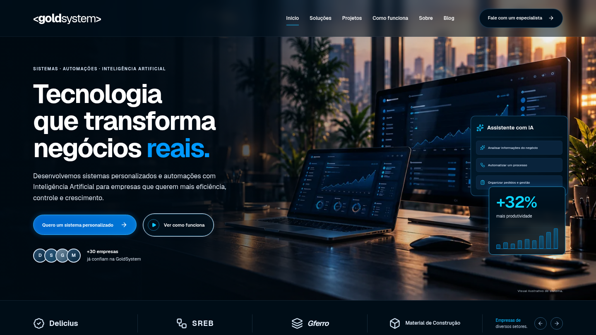

# GoldSystem

Website comercial da GoldSystem, com o mesmo destaque para **sistemas sob medida, automações de processos e Inteligência Artificial**. A apresentação parte dos problemas da operação, demonstra o produto e leva o visitante a um briefing de projeto.

[Ver a prévia desktop](docs/previews/desktop.png) · [Ver a prévia mobile](docs/previews/mobile.png) · [Ver as soluções](docs/previews/solucoes.png) · [Ver a página completa](docs/previews/pagina-completa.png)



## Executar

Requisitos: Node.js 24 e npm. Versões usadas na validação: Node 24.19.0 e npm 11.9.0.

```sh
npm ci
npm run dev
```

Para produção:

```sh
npm run build
npm start
```

O servidor usa a porta 3000 por padrão. `npm start -- --port 3001` permite escolher outra porta. O ambiente de nuvem já fornece um checkout isolado; trabalhe nele, sem criar um Git worktree adicional.

Se o cache npm padrão não for gravável no ambiente de nuvem, use `NPM_CONFIG_CACHE=/tmp/goldsystem-npm` antes dos comandos npm. Isso não desativa verificações de integridade ou TLS.

## O que está implementado

- Layout inspirado na referência aprovada: fotografias de escritório, azul luminoso, botões arredondados, soluções visuais, simulador, projetos, depoimento, indicadores e FAQ.
- Quatro cartões de soluções abrem a demonstração do módulo correspondente; o assistente apresenta as três frentes de sistemas, automações e IA.
- Laboratório em dialog com oito módulos de gestão, pedidos, filtros, indicadores, reposição demonstrativa, clientes e exportação de CSV.
- Simulação de fluxos e cenários de IA predefinidos, identificados como demonstrações. Não há chamadas a modelos externos.
- Simulador com cinco parâmetros e resultados mensais/anuais calculados; o contexto acompanha o briefing.
- Galeria de projetos com detalhes e comparação interativa de sistemas por segmento.
- Contato direto pelo WhatsApp e e-mail confirmados. O briefing pode ser copiado, baixado ou levado ao WhatsApp; o envio da mensagem é confirmado pelo visitante no aplicativo.
- Blog com três artigos e rotas próprias. Fontes locais, imagens WebP, metadados, navegação por teclado e movimento reduzido.

Clientes, descrições de projetos, depoimento, indicadores e contatos da referência foram confirmados pelo responsável para publicação. Fotografias são ilustrações geradas; detalhes em [docs/ASSETS.md](docs/ASSETS.md). Os dados do laboratório são fictícios e ficam na memória da página. O formulário não grava em cookies, localStorage ou banco.

## Estrutura principal

| Local                                   | Responsabilidade                                  |
| --------------------------------------- | ------------------------------------------------- |
| `src/components/gold-system.tsx`        | Página comercial, galeria e contexto da proposta  |
| `src/components/reference-shell.tsx`    | Navegação, marca, rodapé e contatos               |
| `src/components/site-dialog.tsx`        | Janelas nativas, foco e fechamento                |
| `src/app/reference.css`                 | Identidade visual e responsividade                |
| `src/components/dashboard.tsx`          | Módulos e pedidos demonstrativos                  |
| `src/components/laboratory.tsx`         | Demonstrações de gestão, automação e IA           |
| `src/components/simulator.tsx`          | Simulador e período de resultado                  |
| `src/lib/simulation.ts`                 | Fórmula e limites dos parâmetros                  |
| `src/components/contact.tsx`            | Formulário, briefing e WhatsApp                   |
| `src/config/commercial.ts`              | Contatos, clientes e dados comerciais confirmados |
| `src/app/blog/` e `src/lib/articles.ts` | Blog e conteúdo dos artigos                       |
| `src/app/api/briefing/route.ts`         | Validação e encaminhamento opcional               |
| `src/lib/delivery.ts`                   | Transporte HTTPS e confirmação do destino         |

## Configuração comercial e backend

O site funciona sem credenciais. Por padrão, **Gerar meu briefing** prepara um texto para copiar, baixar ou continuar pelo WhatsApp e informa que a geração não enviou dados.

Para ativar o envio, configure no servidor:

```dotenv
BRIEFING_WEBHOOK_URL=https://seu-backend.example/briefings
# Opcional, se o destino exigir autenticação:
BRIEFING_WEBHOOK_TOKEN=valor-inserido-em-configuracao-segura
NEXT_PUBLIC_SITE_URL=https://seu-dominio-verificado.example
```

Use os placeholders somente como orientação; configure seus valores reais em um arquivo local ignorado ou no gerenciador seguro da hospedagem. Não exponha o token com prefixo `NEXT_PUBLIC_`. O domínio do webhook deve estar permitido na saída de rede do ambiente.

O destino pode ser uma Supabase Edge Function ou outro endpoint HTTPS controlado pela GoldSystem. Recebe `POST` JSON:

```json
{
  "fields": {
    "name": "…",
    "company": "…",
    "phone": "…",
    "email": "…",
    "segment": "…",
    "problem": "…",
    "solution": "…",
    "description": "…",
    "consent": true
  },
  "context": {
    "experience": "…",
    "simulation": {
      "employees": 5,
      "hoursPerDay": 2,
      "daysPerMonth": 22,
      "hourlyCost": 35,
      "automationPercent": 60
    }
  },
  "briefing": "Texto completo…"
}
```

O endpoint deve responder `2xx` **depois** de aceitar a entrega. O site aplica timeout de 10 segundos, recusa redirecionamentos e informa falha sem exibir sucesso se o destino não confirmar. A confirmação se refere ao recebimento pelo backend; entrega de e-mail, armazenamento e atendimento dependem dele.

Antes de habilitar envio público, definir retenção de dados, acesso ao backend, proteção contra abuso e canal para exercício dos direitos de privacidade. Rever o texto de privacidade do site conforme a operação real. Os contatos e dados comerciais publicados foram confirmados pelo responsável pelo site.

## Verificação

```sh
npm run lint
npm run typecheck
npm test
npm run build
npm run test:e2e
```

Os testes de unidade usam o runner nativo do Node. Cobrem a fórmula e limites, consentimento, validação do payload, preservação de contexto e sucesso/falha de transporte HTTPS com mocks. Nenhum dado real é enviado nos testes.

Os testes Playwright usam Chromium do sistema quando disponível, a variável `PLAYWRIGHT_CHROMIUM_EXECUTABLE` quando definida, ou o navegador instalado pelo Playwright. Para preparar o navegador fora da nuvem:

```sh
npx playwright install chromium
```

O Playwright inicia a versão de produção; execute o build antes. Se já houver servidor na porta 3000, ele deve corresponder ao build atual. Não reconstrua `.next` enquanto estiver validando um servidor existente.

O cenário de contato integrado abre um servidor temporário na porta 3002 e simula respostas HTTP no navegador. Verifica carregamento, bloqueio de edição, falha e confirmação sem chamar um webhook externo. Mantenha essa porta disponível durante os testes.

São exercitados pedidos, busca, filtros, módulos, automação, cenários de IA, sliders, comparação, briefing, cópia, download, API, teclado, dialogs, galeria, blog, menu mobile e contraste com axe. Capturas completas em 1440, 1280, 768 e 390 px ficam em `test-results/`; o relatório fica em `playwright-report/` (ambos ignorados). Use `npx playwright show-report` para inspecionar localmente.

As capturas documentam o HTML e as interfaces efetivamente renderizadas no navegador. As prévias selecionadas para revisão ficam em `docs/previews/`.

## Publicação

O projeto requer hospedagem com suporte ao servidor Next.js se o envio de briefing for ativado. Configure o domínio real para os metadados sociais e valide o destino comercial. Os projetos e indicadores publicados foram autorizados; as fotografias e os dados das demonstrações são ilustrativos.

LCP ≤ 2,5 s, INP ≤ 200 ms e CLS ≤ 0,1 são metas. A validação de layout e funcionalidade em Chromium local não comprova Core Web Vitals em produção. Medir em dispositivos e redes representativos após publicar, incluindo navegadores móveis reais.

Na Vercel, importe este repositório com o preset Next.js, diretório raiz `./`, instalação `npm ci`, build `npm run build` e Node.js 24.x. Mantenha o diretório de saída padrão. A integração com o GitHub pode publicar novas versões a cada push. O envio comercial e o banco de dados dependem da configuração do backend escolhido.
